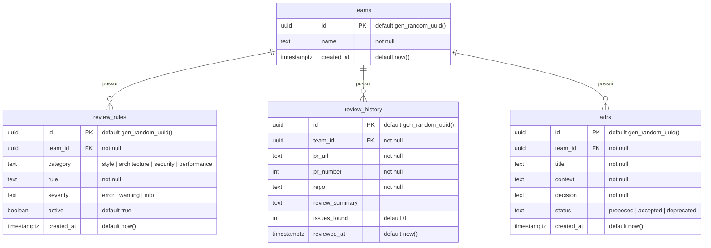

# Plano — Supabase MCP no projeto DevReview

Fontes: README de https://github.com/supabase/mcp e a página oficial https://supabase.com/docs/guides/getting-started/mcp (consultadas em 2026-11-09, página "Updated Nov 6, 2026").

## 1. O que a documentação diz

- O Supabase MCP é um servidor **remoto HTTP** (`https://mcp.supabase.com/mcp`) com login **OAuth** no navegador; não precisa de token pessoal (PAT).
- Para **Supabase local (CLI)** o endpoint é `http://localhost:54321/mcp`, com **subconjunto limitado de tools e sem OAuth 2.1**. O grupo *Notebooks* não existe na CLI.
- Para Claude Code, a doc indica `claude mcp add --scope project --transport http ...` ou editar o `.mcp.json` com `"type": "http"` e `"url"`.
- Parâmetros de URL (hosted): `project_ref` (escopa a um projeto e desativa as tools de conta), `read_only=true` (desativa tools que alteram dados) e `features=` (grupos: `docs, account, database, debugging, development, functions, branching, feedback, notebooks`; `storage` vem desligado por padrão).
- Recomendações de segurança da Supabase: usar em desenvolvimento (não em produção), ativar read-only, escopar por projeto e manter a aprovação manual das chamadas de tool.

## 2. Decisão de configuração (resolve a pendência do PRD anterior)

O PRD do mcp-server assumia o pacote `@supabase/mcp-server-supabase` via STDIO com token. A documentação atual aponta para **HTTP**, então o `.mcp.json` usa o endpoint **local da CLI**, que combina com o curso (dados locais, sem conta/nuvem, sem OAuth).

`.mcp.json` (raiz do projeto):

```json
{
  "mcpServers": {
    "supabase-devreview-local": {
      "type": "http",
      "url": "http://localhost:54321/mcp"
    }
  }
}
```

**Evitar conflito com configurações globais:**
- Nome exclusivo (`supabase-devreview-local`), em vez de `supabase`, que é o nome que a doc usa e que um servidor global teria. Em Claude Code, nomes iguais em escopos diferentes se sobrepõem (local > projeto > usuário); nome distinto elimina a ambiguidade.
- Hoje o `~/.claude.json` não tem nenhum MCP de usuário nem do projeto; portanto não há conflito atual.
- Sem segredos no arquivo: o endpoint local não usa credencial, então o `.mcp.json` pode ser versionado.
- O Claude Code pede aprovação na primeira vez que carrega servidores de `.mcp.json` de projeto.

## 3. Passos de implementação

1. Ligar o Docker Desktop.
2. `npx supabase start` e depois `npx supabase db reset` (já corrigimos o `[local_smtp]` no `config.toml`).
3. Confirmar o endpoint: `curl -i http://localhost:54321/mcp` deve responder (um 4xx de método/aceite já indica que o endpoint existe; conexão recusada indica Supabase parado).
4. Reiniciar a sessão do Claude Code na raiz do projeto, aprovar o servidor de projeto e checar com `claude mcp list` (ou `/mcp` no terminal interativo).
5. Teste de fumaça em linguagem natural: "Liste as tabelas do banco usando as tools do Supabase MCP". Esperado: `teams`, `review_rules`, `review_history`, `adrs`.
6. Opcional: abrir o Supabase MCP no MCP Inspector (transporte *Streamable HTTP*, URL `http://localhost:54321/mcp`) para comparar suas tools com as do `devreview-mcp`, que é o que o curso explora.

## 4. Servidor hosted (projeto na nuvem, já no `.mcp.json`)

Projeto criado em supabase.com: `https://ehbblydlzvamhttsjlxx.supabase.co` (project ref `ehbblydlzvamhttsjlxx`). Segundo servidor, também com nome exclusivo:

```json
"supabase-devreview-cloud": {
  "type": "http",
  "url": "https://mcp.supabase.com/mcp?project_ref=ehbblydlzvamhttsjlxx&read_only=true&features=database,debugging,development,docs"
}
```

- `project_ref`: escopa ao projeto devreview e desativa as tools de conta (listar/criar projetos).
- `read_only=true`: padrão seguro, conforme a recomendação da Supabase. Isso **bloqueia** `apply_migration` e `execute_sql` de escrita; para criar o schema/seed na nuvem, será preciso trocar para `read_only=false` temporariamente, ou aplicar as migrations por outro caminho (`supabase db push`).
- `features`: só `database`, `debugging`, `development` e `docs`.
- Autenticação: OAuth no navegador, em `/mcp` → *supabase-devreview-cloud* → *Authenticate*; escolher a organização que contém o projeto. Nenhuma chave vai para o arquivo (a publishable key é do frontend, não do MCP).
- A migration `supabase/migrations/00001_init_schema.sql` e o `supabase/seed.sql` já foram aplicados no projeto da nuvem (conferido: 1 time, 8 regras, 7 ativas, 6 reviews, 5 ADRs).

## 5. Modelo de dados (schema `public`)

Derivado de `supabase/migrations/00001_init_schema.sql`. Todas as tabelas filhas pertencem a um time (`team_id`) e são removidas em cascata (`on delete cascade`).



Observação de segurança: nas 4 tabelas da nuvem o **RLS está desligado e não há policies** (verificado em 2026-11-09). A decisão sobre isso foi adiada para as próximas aulas do curso.

## 6. Riscos e observações

- O servidor local tem **menos tools** que o hosted; a lista exata deve ser conferida ao conectar.
- O `.mcp.json` não aceita comentários; as justificativas ficam aqui.
- O `devreview-mcp` (nosso servidor STDIO) não foi colocado no `.mcp.json`: ele é objeto de estudo do curso e é aberto pelo Inspector. Pode ser adicionado depois se o curso pedir.
- O pacote `@supabase/mcp-server-supabase` instalado como devDependency deixou de ser necessário para este fluxo; pode ser removido ou mantido para estudo.
- Esta configuração **não foi testada**: o Docker/Supabase local está desligado.
